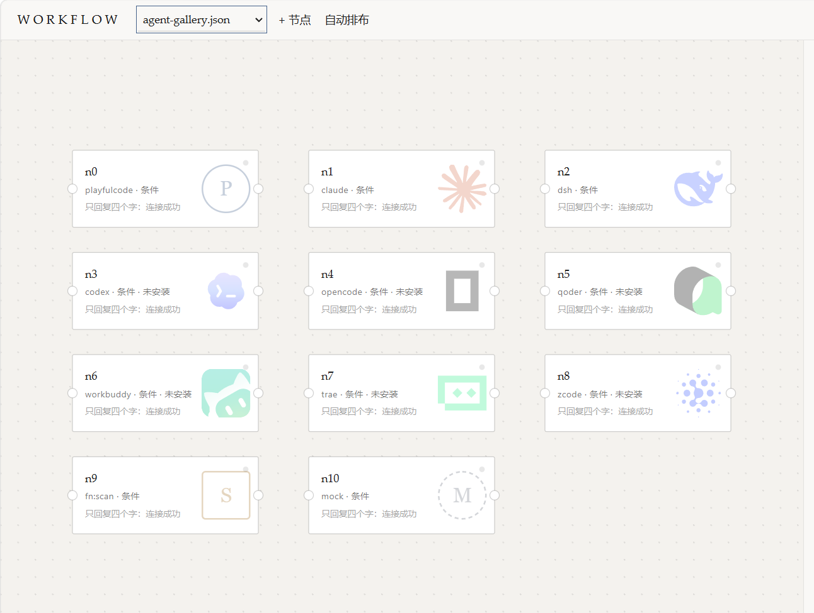
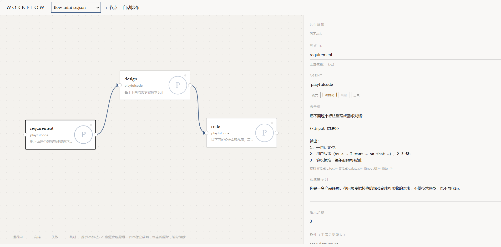

# Workflow

中文 | English（待补）

> 项目演示地址：【AgentWorkflow作业】 https://www.bilibili.com/video/BV1tfn66mEsM

Workflow 是一个多 Agent 工作流引擎。它把 Claude Code、DeepSeek Harness、Codex、Qoder 等主流 Agent（智能体）和自研 Agent 包装成同一种节点，按依赖关系编排成可追踪、可回放的流水线。

设计文档：[DESIGN.md](DESIGN.md)

## 为什么做这个

单个 Agent 能把一个任务做完，但做不完一件事。

真实的任务是分阶段的：需求要先定清楚，设计要定结构，代码要有人写，写完要有人从另一个角度挑毛病，最后还要有人判断能不能合并。这些阶段需要的上下文、权限和模型都不一样。把五个阶段塞进一个 Agent 的一次对话，等于让它同时扮演五种角色，每一种都做不好。

这个项目把三件事拆开：状态放在黑板上，Agent 收敛成同一种节点，流程写成数据。

三条主张：

**一、显式共享状态，而不是提示词拼接。** 每个节点只写自己的槽位，下游按名字读。任意时刻的黑板快照都能解释一份结论是怎么推出来的。

**二、Agent 是同一种节点。** 一个库调用、一个确定性函数、一个只提供 CLI 的外部工具，对引擎而言没有区别。新增平台是加一份声明，不是改调度器。

**三、编排是数据，不是代码。** 工作流是一份 JSON，条件、循环、重试、并行都在里面。它可以被校验、被可视化编辑、被版本管理。

## 支持的 Agent



| Agent | 接入方式 |
|---|---|
| `playfulcode` | 库调用（项目一自研 Agent，带工具循环与会话记忆） |
| `fn:scan` | 确定性函数（静态规则扫描） |
| `mock` | 离线替身，用于流程与引擎测试 |
| `claude` | `claude -p --output-format stream-json` |
| `dsh` | `dsh --profile headless --json` |
| `codex` | `codex exec --json` |
| `opencode` | `opencode run --format json` |
| `qoder` | `qoder -p --output-format stream-json` |
| `workbuddy` | `codebuddy -p --output-format json` |
| `zcode` | `zcode --prompt … --json` |
| `trae` | `trae-cli run "<task>"` |

未安装的 Agent 也可以先加进流程：节点会标注「未安装」，跑到这一步才失败，并给出明确原因。

## 内置工作流

| 文件 | 流程 | Agent 分工 |
|---|---|---|
| `flow-mini-se.json` | 需求 → 设计 → 代码 | 需求 Agent · 设计 Agent · 编码 Agent（仅编码可写盘） |
| `flow-code-review.json` | 编码 → 审查 → 修复 | 编码 Agent · 审查 Agent（Claude Code）· 修复 Agent |
| `flow-doc-gen.json` | 代码 → 分析 → 文档 | 分析 Agent（只读）· 文档 Agent（写盘） |
| `flow-testing.json` | 代码 → 生成测试 → 执行 | 测试生成 Agent · 测试执行 Agent（真跑测试） |
| `flow-content.json` | 主题 → 大纲 → 内容 → 审校 | 规划 Agent · 写作 Agent · 审校 Agent（Claude Code） |
| `code-review.json` | 扫描 → 质量/安全双路并行 → 汇总 | fn:scan · Claude Code · DeepSeek Harness · PlayfulCode |
| `multi-agent.json` | 扫描 → Claude 复核 → DeepSeek 汇总 | 三种运行时混跑 |
| `agent-gallery.json` | 11 个 Agent 各一节点，只看标识与可用性 | 默认全部跳过，不产生任何调用 |

刻意的设计：

- **权限按节点收窄。** 需求、设计、分析节点挂 `tools: "none"` 或 `"review"`，只有真正要落盘的节点才给 `"default"`。
- **测试执行节点是真的跑。** 执行节点用 Agent 的 `run_code` 工具执行测试命令；提示词里写明「跑不起来就直说，不要假装通过」。

## 作业要求对照

| 要求 | 实现 | 位置 |
|---|---|---|
| **必须**：至少 2 个 Agent 协作完成完整流程 | 内置 8 条流程，最多 4 节点 3 Agent | `workflows/` |
| **必须**：Agent 间消息传递或状态共享 | 黑板 + `{{nodeId.text}}` 模板；`consumes` 追踪数据流向 | `src/core/blackboard.ts` |
| **必须**：基本流程控制（顺序执行） | `dependsOn` 构成 DAG，依赖满足即执行 | `src/core/engine.ts` |
| **必须**：MVP 可运行 | `npm run build && npm run demo`；离线模式 `--mock` | — |
| **推荐**：条件分支 | 结构化 `when`，不使用 eval | `engine.ts` |
| **推荐**：循环 | `forEach`，逐项执行并合并产出 | `engine.ts` |
| **推荐**：并行执行 | 无依赖节点同批并发，`--concurrency` 限流 | `engine.ts` |
| **推荐**：可视化编排界面 | 零依赖 SVG 画布，支持拖拽、连线、改提示词、选 Agent、实时状态 | `src/web/` |
| **推荐**：执行日志与状态追踪 | `trace.jsonl` 事件流 + `outputs.md` 产出快照 + 控制台渲染 | `src/core/trace.ts` |
| **推荐**：错误处理与恢复 | 重试退避、失败传播、失败节点留痕；断点续跑未实现 | `engine.ts` |

已知缺口：**断点恢复**只有重试，没有持久化快照。进程被杀需要整体重跑。补它需要先定「快照存哪、什么时候存」，属于设计决策而非技术缺口，故未在本版实现。

## 运行

需要 Node.js 18.17 以上。

```sh
npm install
npm run build

cp .env.example .env      # 然后把 PC_ROOT 改成你本机 PlayfulCode 仓库的路径
```

`PC_ROOT` 是静态扫描节点和 Agent 节点定位 PlayfulCode 的唯一入口。仓库里不写死任何本机路径。

**PlayfulCode 是可选依赖。** 不配置也能跑：`playfulcode` 节点会明确报错并提示替代方案，`fn:scan` 自动退回内置扫描器（`src/drivers/fallback-scan.ts`，6 条规则，规则集刻意做小）。`multi-agent.json` 完全不依赖 PlayfulCode，装了 Claude Code 或 DeepSeek Harness 就能端到端跑通。

离线跑一遍（不调用任何模型）：

```sh
node dist/cli.js run workflows/code-review.json --mock
```

真实运行：

```sh
node dist/cli.js run workflows/code-review.json
node dist/cli.js run workflows/multi-agent.json --workdir D:/your/repo
```

产出落在 `runs/<runId>/`：`trace.jsonl` 是逐条事件，`outputs.md` 是每个节点的完整产出。

<a id="web"></a>

## 可视化编排

```sh
npm run web        # http://127.0.0.1:3081
```



浏览器里可以拖节点、从右侧圆点拉线建立依赖、点连线删除、改提示词与 Agent，运行时节点按依赖顺序点亮。点任意节点可在右侧看到它的完整产出。

两个便于演示的 URL 参数：`?autorun=mock` 打开即跑一遍模拟，`?select=quality` 直接选中某个节点。

前端是零依赖单页：原生 DOM + SVG，没有打包工具。服务端只用 `node:http`，运行状态通过 SSE 推送。

## 设计要点

### 状态放在黑板上，而不是提示词里

**问题。** 多步流程里，下游需要上游的结果；但「把上一步输出拼进提示词」让数据流消失在字符串里。

**决策。** 黑板只增不删，节点只写自己的槽位，下游用 `{{nodeId.text}}` 读取。模板只支持路径取值，不支持表达式——模板一旦能计算，工作流 JSON 就变成半门编程语言，校验和可视化都会失效。连接口都从模板自动推导出来，写进 `node_start` 事件。

### Agent 收敛成一种节点

**问题。** PlayfulCode 有可编程接口，Claude Code 只有 CLI，静态扫描根本不需要模型。

**决策。** 定义唯一的 `AgentDriver` 接口，三个实现：库调用、子进程、确定性函数。外部平台的差异收敛成一份声明（可执行文件、参数模板、输出解析器），加平台只需在 `presets.ts` 加一条。


### 能力写在数据里，不写在注释里

**问题。** 各平台能力确实不同：Claude 有 `--json-schema` 能保证结构化输出，也有 `--resume` 续跑会话；Codex 两者都没有。DeepSeek Harness 的会话是持久化的，续跑靠 `--session-id`——它和「DeepSeek 模型 API 本身无状态」是两件事，不能混为一谈。

**决策。** `capabilities` 是 Driver 的必填字段（`streaming` / `structured` / `resume` / `tools`），编排期可读。


### 失败要说清楚，成功也要说清楚

**问题。** 第一次真实运行时，三个节点全部耗尽步数预算，却都返回 `ok`：跑了 8 步工具调用，一个结论都没给。

**决策。** 区分「跑完了」和「得出结论了」。Driver 上报 `stopReason`，引擎在 `max_steps` 时打警告；失败节点也会写入黑板，否则「谁失败了」无从查起。


## 项目结构

```
src/
  core/
    types.ts       全部跨模块契约
    engine.ts      DAG 调度：顺序、并行、条件、循环、重试、失败传播
    blackboard.ts  Agent 间共享状态与模板渲染
    trace.ts       JSONL 追踪与控制台渲染
  drivers/
    playfulcode.ts 库调用（项目一的 Agent）
    functions.ts   确定性节点（有 PlayfulCode 用其规则引擎，否则用内置扫描器）
    fallback-scan.ts 内置静态扫描：没有 PlayfulCode 时的兜底
    mock.ts        离线替身
    cli/           外部 CLI：声明式适配
      presets.ts   各平台参数（加平台只改这里）
      driver.ts    通用子进程 Driver
      parsers.ts   各平台输出解析
  web/             可视化编排（服务端 + 零依赖前端）
workflows/         8 条内置流程
```

## 扩展

加一个 Agent 有两种情况：

- **已有平台，改参数。** 在节点的 `config` 里覆盖 `bin` / `args` / `model` / `cwd`，不用改代码。
- **新平台。** 在 `src/drivers/cli/presets.ts` 加一条声明；只有当输出格式与现有五种解析器都不同时，才需要写新解析器。

改流程不需要改代码，编辑 `workflows/*.json` 即可，或用可视化界面。


## 许可证

MIT。第三方图标来自 [Lobe Icons](https://github.com/lobehub/lobe-icons)（MIT），商标归各公司所有。
